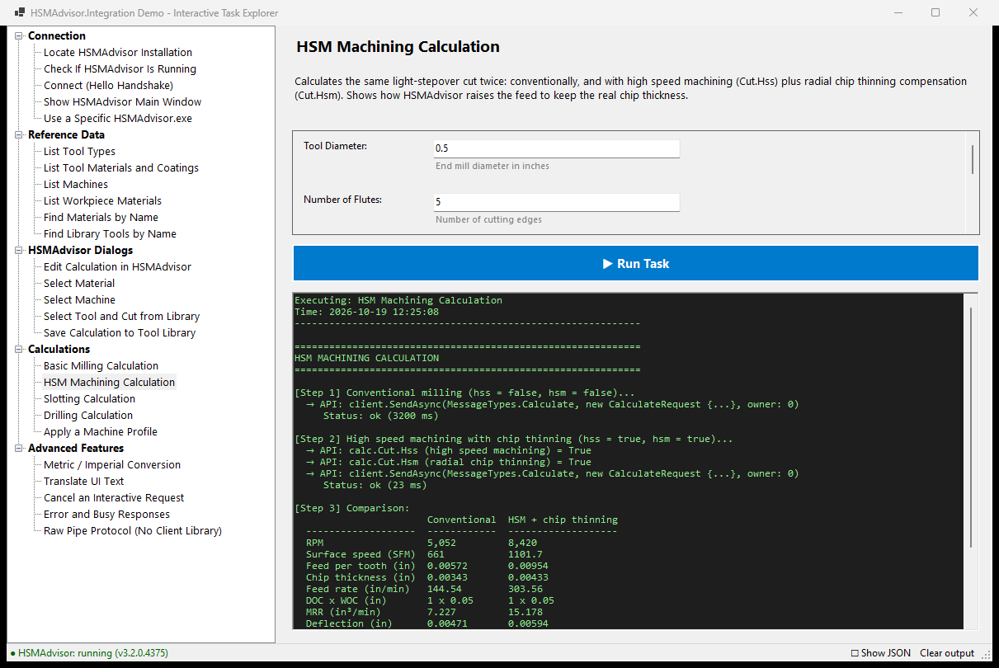

# HSMAdvisor.Integration-Demo

A demonstration project for **HSMAdvisor.Integration.dll**, the library that lets your application use the installed **HSMAdvisor** app as a speeds and feeds server. It includes a Windows Forms test application with interactive, task-based demos showing how to add HSMAdvisor calculations and dialogs to a CAM system or other software.

The HSMAdvisor Mastercam hooks use this same integration. HSMAdvisor can be downloaded from https://hsmadvisor.com/download.

To learn more about HSMAdvisor and its features, visit https://hsmadvisor.com/.

## Screenshot


## How it differs from the DLL integration

The older [HSMAdvisor-DLL-Test](https://github.com/swindex/HSMAdvisor-DLL-Test) loads `HSMAdvisorCore.dll` into your own process. With HSMAdvisor.Integration:

- **Nothing from HSMAdvisor runs inside your process.** Your application sends JSON messages over a per-user named pipe to the separately installed `HSMAdvisor.exe`.
- **It works with any .NET runtime.** `HSMAdvisor.Integration.dll` comes in a `net48` build and a `net8.0` build (usable from .NET 8/10 hosts such as Mastercam 2027). `HSMAdvisorCore.dll` only runs on .NET Framework.
- **HSMAdvisor updates itself.** Your integration does not ship HSMAdvisor binaries. It works with whatever HSMAdvisor version is installed, as long as it is at least the minimum version you set.
- **Licensing and user data stay in HSMAdvisor.** Calculations use the user's own materials, machines, tool library and license.
- **Other languages can use it too.** The wire format is length-prefixed JSON, so Python, C++ and other clients can talk to the pipe directly. The "Raw Pipe Protocol" task shows how.

## Overview

The demo application has 26 interactive tasks in 5 categories:

- **Connection**: locate the HSMAdvisor installation, check whether it is running, connect with the Hello handshake, show the main window, and use a specific HSMAdvisor.exe
- **Reference Data**: tool types, tool materials and coatings, machines and workpiece materials; find materials by name; find library tools by name
- **HSMAdvisor Dialogs**: edit a calculation in the full HSMAdvisor calculator, pick a material, machine or library tool/cut, and save a cut to the tool library
- **Calculations**: milling, HSM with chip thinning, slotting, drilling, and calculating for a machine profile, all without UI
- **Advanced Features**: metric/imperial conversion, translations, cancelling an interactive request, error and busy responses, and the raw pipe protocol

## Key Features

### Task-Based Architecture
Like HSMAdvisor-DLL-Test, every demo is a self-contained task with:
- Configurable parameters with dynamic UI generation
- Step-by-step execution logging
- Detailed API call tracking and result formatting
- Category-based organization in a tree view

### Asynchronous, Cancellable Requests
Tasks run asynchronously, so the demo window stays responsive while an HSMAdvisor dialog is open. While a task runs, the **▶ Run Task** button changes to **■ Cancel**. Cancelling closes the pipe connection, and HSMAdvisor then closes the dialog it opened for that request. HSMAdvisor dialogs are owned by the demo window, so they stay in front of it.

### Protocol Inspection
Click **☐ Show JSON** in the status bar to print the JSON payload of every request and response. The status bar also shows whether HSMAdvisor is running and which version it is.

## Project Structure

```
HSMAdvisor.Integration-Demo/
├── HSMAdvisor.Integration-Demo.sln    # Visual Studio solution
├── README.md                          # This file
├── lib/
│   ├── net48/HSMAdvisor.Integration.dll    # .NET Framework 4.8 build
│   └── net8.0/HSMAdvisor.Integration.dll   # .NET 8+ build
├── IntegrationDemo/                   # Demo application (net48 + net8.0-windows)
│   ├── Program.cs                     # Application entry point
│   ├── MainForm.cs                    # Main UI form with task tree
│   ├── MainForm.Designer.cs           # UI designer file
│   ├── DemoTask.cs                    # Base task class, TaskContext and output formatting
│   ├── IntegrationSession.cs          # The shared HSMAdvisorClient
│   ├── Samples.cs                     # Sample end mill / drill calculations
│   └── Tasks/                         # Demo task implementations
│       ├── ConnectionTasks.cs         # Locate, Hello, show main window
│       ├── ReferenceDataTasks.cs      # Tool types, materials, machines, library lookup
│       ├── DialogTasks.cs             # Interactive HSMAdvisor dialogs
│       ├── CalculationTasks.cs        # Headless calculations
│       └── AdvancedTasks.cs           # Units, translations, cancel, errors, raw pipe
└── IntegrationSamples/                # Console code samples (net48 + net8.0)
    ├── Program.cs                     # Creates the client, sample menu, Ctrl+C and error handling
    ├── ISample.cs                     # Sample interface
    ├── SampleData.cs                  # Sample end mill / drill calculations
    └── Samples/                       # One file per sample, 01_Connect.cs ... 12_RawPipeProtocol.cs
```

## Code Samples (Console)

`IntegrationSamples` is a console app with short, commented samples that call `HSMAdvisorClient` directly, without the demo application's UI and logging code. Each sample is one file in `IntegrationSamples/Samples/` that you can copy into your own integration.

```
dotnet run --project IntegrationSamples -f net8.0          # pick a sample from the menu
dotnet run --project IntegrationSamples -f net8.0 -- 3     # run sample 3
```

| # | Sample | Messages |
|---|---|---|
| 1 | Locate HSMAdvisor, check its version, connect | `Hello` |
| 2 | Tool types, tool materials, coatings, machines, workpiece materials | `GetReferenceData`, `FindMaterials` |
| 3 | End mill speeds and feeds, conventional vs. HSM with chip thinning | `Calculate` |
| 4 | Drilling and slotting | `Calculate` |
| 5 | Calculating for a machine profile | `GetReferenceData`, `Calculate` |
| 6 | Converting a calculation to metric | `ConvertUnits` |
| 7 | Editing a calculation in the HSMAdvisor calculator | `EditCalculation` |
| 8 | Material, machine and library cut pickers | `SelectMaterial`, `SelectMachine`, `SelectCut` |
| 9 | Saving a cut to the tool library, then finding and loading the tool | `AddCut`, `FindTools`, `GetTool` |
| 10 | Text in the user's HSMAdvisor language | `Translate` |
| 11 | Cancelling a dialog from code; error and busy responses | `EditCalculation`, `GetTool`, `SelectMaterial` |
| 12 | Talking to the pipe without the client library | raw frames |

Samples 7, 8, 9 and 11 open HSMAdvisor dialogs. Press Ctrl+C to cancel a running sample; this also closes any dialog it opened.

## Getting Started

### Prerequisites
* Microsoft Windows 10 or 11
* **HSMAdvisor 3.2.0 or later** installed (https://hsmadvisor.com/download)
* Visual Studio 2022 or later, or the .NET 8 SDK or later
* .NET Framework 4.8 Developer Pack (for the `net48` build)

### Building the Application

1. Clone this repository and open `HSMAdvisor.Integration-Demo.sln` in Visual Studio, or build from the command line:
   ```
   dotnet build HSMAdvisor.Integration-Demo.sln
   ```
2. Run the application (F5). Visual Studio starts the first target framework (`net8.0-windows`). To run the .NET Framework build, choose `net48` in the framework drop-down next to the Start button.

Output: `IntegrationDemo\bin\<Configuration>\net8.0-windows\` and `...\net48\`.

### Finding HSMAdvisor
The client looks for `HSMAdvisor.exe` in this order:
1. the `HSMADVISOR_EXE` environment variable
2. `Software\HSMAdvisor\ExePath` in HKCU/HKLM (written by the HSMAdvisor installer)
3. the HSMAdvisor uninstall entry
4. `Program Files\HSMAdvisor`

To use a portable copy or a development build, set `HSMADVISOR_EXE` or run the **Use a Specific HSMAdvisor.exe** task.

### Using the Application

1. **Select a task** in the task tree on the left.
2. **Configure parameters**, if the task has any, in the parameters panel.
3. **Run the task** with "▶ Run Task". The first request starts HSMAdvisor in integration mode, without a main window. This can take a few seconds.
4. **View the results** in the output panel: API calls, response status and timing, results, and errors or warnings.

HSMAdvisor stays running in the background while the demo runs, and exits a few seconds after the demo closes.

## Code Examples

### Connecting
```csharp
using HSMAdvisor.Integration;
using HSMAdvisor.Integration.Client;
using HSMAdvisor.Integration.Protocol;
using static HSMAdvisor.Integration.Records.Enums;

// Keep one client for the life of your application
var client = new HSMAdvisorClient(new ClientInfo { Name = "My CAM", Version = "1.0" })
{
    MinimumVersion = new Version(3, 2, 0), // older HSMAdvisor -> IntegrationException "version_too_old"
};
```

### Calculating Speeds and Feeds (no UI)
```csharp
var calc = new CalculationData();
calc.Tool.Tool_type_id = ToolTypes.SolidEndMill;
calc.Tool.Tool_material_id = ToolMaterials.Carbide;
calc.Tool.Coating_id = ToolCoatings.TiAlN;
calc.Tool.Diameter = 0.5;
calc.Tool.Flute_N = 4;
calc.Cut.Material_id = 227;   // 1018 steel, license-free
calc.Cut.Doc = 0.5;
calc.Cut.Woc = 0.1;
calc.Cut.Hss = true;           // high speed machining
calc.Cut.Hsm = true;           // radial chip thinning compensation

var result = await client.RequestAsync<CalculationPayload>(MessageTypes.Calculate,
    new CalculateRequest { Calculation = calc, PresetSpeeds = true }, 0, CancellationToken.None);

Console.WriteLine($"RPM: {result.Calculation.Cut.Rpm}");
Console.WriteLine($"Feed: {result.Calculation.Cut.Feed:F1} in/min");
```
Only set what you know: fields you leave unset take HSMAdvisor's defaults. Each value's unit comes from its own `*_m` flag (`Doc_m`, `Feed_m`, ...).

### Letting the User Edit the Calculation in HSMAdvisor
```csharp
using (var cts = new CancellationTokenSource())   // cts.Cancel() closes the HSMAdvisor dialog
{
    var edited = await client.RequestAsync<CalculationPayload>(MessageTypes.EditCalculation,
        new EditCalculationRequest { Calculation = calc, Prompt = "Click OK to apply the cut" },
        myForm.Handle.ToInt64(),   // HSMAdvisor's window is owned by your window
        cts.Token);

    if (edited == null)
    {
        // The user clicked Cancel in HSMAdvisor
    }
}
```
`RequestAsync` throws `IntegrationException` for `error` and `busy` responses. Its `Code` is, for example, `not_found`, `not_installed` or `version_too_old`.

### Talking to the Pipe Directly
```
pipe:     \\.\pipe\HSMAdvisor.Integration.v1.<session-id>.<domain>.<user>
frame:    4-byte little-endian length + UTF-8 JSON
request:  { "protocol": 1, "id": "...", "type": "Hello", "client": { "name": "..." }, "owner_window": 0, "payload": null }
response: { "protocol": 1, "id": "...", "status": "ok|cancelled|error|busy", "error": {...}, "payload": {...} }
```
Each connection carries one request. If the client closes the connection before the response arrives, HSMAdvisor treats the request as cancelled. Only one interactive (dialog) request runs at a time; a second one gets `busy`.

## Messages

| Message | Purpose | UI |
|---|---|---|
| `Hello` | HSMAdvisor version, protocol, data folder, process id | – |
| `ShowMainWindow` | Open HSMAdvisor's main window | main window |
| `EditCalculation` | Full calculator with OK/Cancel | dialog |
| `SelectCut` | Pick a tool and cut from the library | dialog |
| `AddCut` | Save a calculation to the tool library | dialog |
| `Calculate` | Speeds and feeds | – |
| `ConvertUnits` | Convert a calculation to metric or imperial | – |
| `SelectMachine` / `SelectMaterial` | Machine or material picker | dialog |
| `GetReferenceData` | Tool types, tool materials, coatings, machines, materials | – |
| `FindMaterials` / `FindTools` / `GetTool` | Look up materials and library tools | – |
| `Translate` | Text in the user's HSMAdvisor language | – |

## Extending the Demo Application

1. **Create a new task class** that inherits from `DemoTask` (or from `EndMillTask` to reuse the end mill parameters)
2. **Define parameters** in the constructor using `TaskParameter` objects
3. **Implement `ExecuteAsync`**, using `ctx.RequestAsync<T>(...)` to send requests with logging and `ctx.Write(...)` for output
4. **Add it to the task list** in `MainForm.LoadAllTasks()`

```csharp
public class MyCustomTask : DemoTask
{
    public MyCustomTask()
    {
        Name = "My Custom Task";
        Description = "Demonstrates a custom feature";
        Category = "Custom Examples";
    }

    public override async Task ExecuteAsync(TaskContext ctx, Dictionary<string, object> parameterValues)
    {
        ctx.Write(OutputFormatter.FormatHeader("MY CUSTOM TASK"));
        var hello = await ctx.RequestAsync<HelloResponse>(MessageTypes.Hello);
        ctx.Write(OutputFormatter.FormatSuccess($"HSMAdvisor {hello.AppVersion}"));
    }
}
```

## License and Distribution

You can distribute `HSMAdvisor.Integration.dll` with your integration. Calculations run in the user's installed HSMAdvisor and follow its license.

## Copyright

© Eldar Gerfanov, HSMAdvisor Inc. All rights reserved.

## Support

For questions, support, or licensing information, visit:
- Website: https://hsmadvisor.com/
- Download: https://hsmadvisor.com/download
